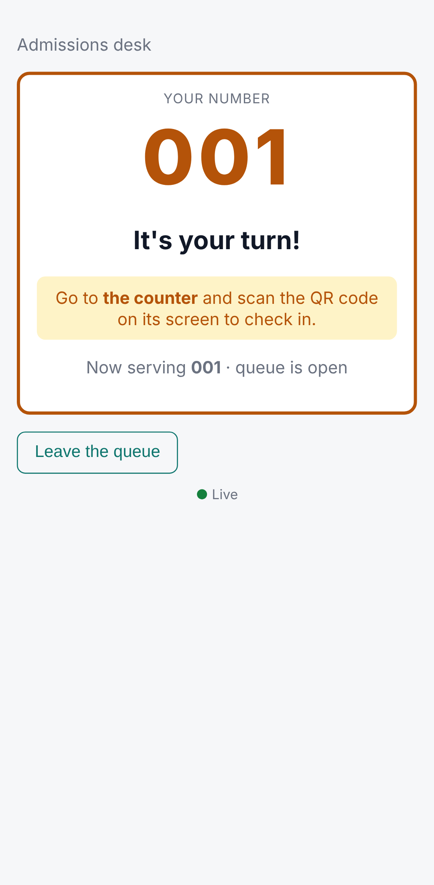
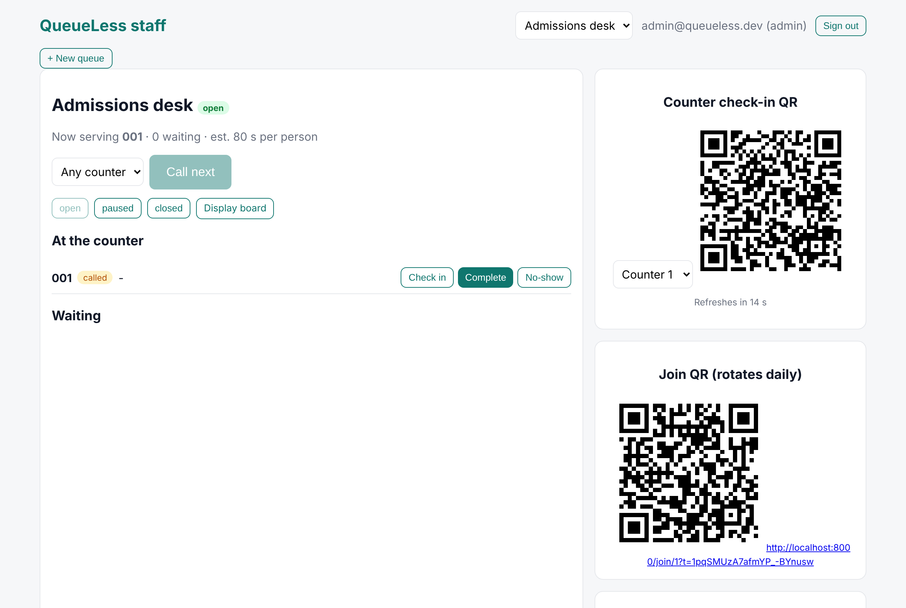
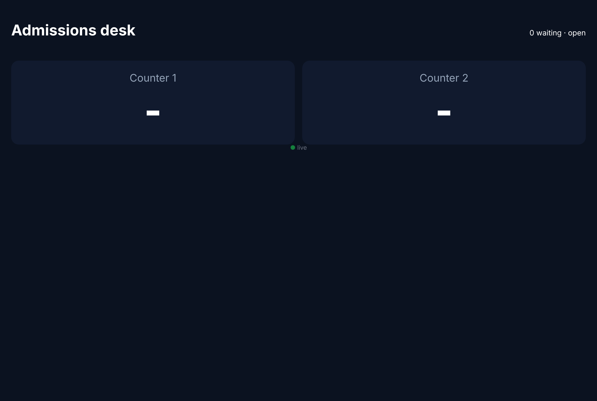
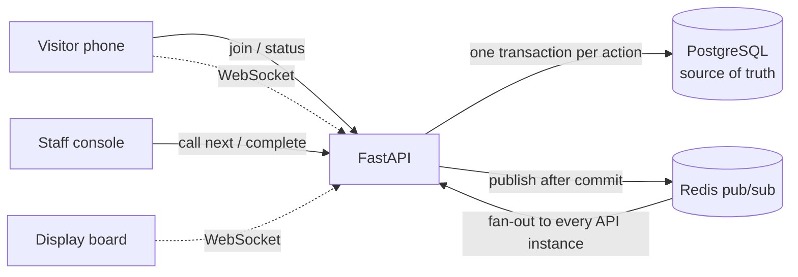

# QueueLess

A virtual queue for college offices, hospital counters and campus events. Visitors scan a QR code to join, watch their live position and wait time on their phone, and walk up when called. Staff call the next person, check visitors in, and handle cancellations and no-shows.

**Stack:** FastAPI · React · PostgreSQL · Redis · WebSockets · QR workflows · Docker

| Visitor (phone) | Staff console | Display board |
|---|---|---|
|  |  |  |

## Architecture



The key ideas, each explained in [`docs/DESIGN.md`](docs/DESIGN.md) and the [decision records](docs/adr/):

- **Two staff press "call next" at once:** `FOR UPDATE SKIP LOCKED` gives them different tickets, so nobody is called twice.
- **Joins are idempotent:** a browser-generated request ID plus a unique constraint, so a retried join returns the same ticket.
- **Positions are computed, not stored:** every ticket has an increasing `seq`, and a cancellation changes one row instead of everyone's.
- **Realtime:** PostgreSQL holds the truth and Redis only carries events, published after commit. Each socket gets a snapshot on connect, and the client falls back to polling if the socket drops.
- **ETA:** an EWMA of observed service times, `ETA = (position − free counters) × est ÷ counters`.
- **QR security:** the join QR is HMAC-signed and rotates daily. The counter check-in QR rotates every 30 s, so a photo of it stops working. Only a hash of each ticket token is stored.

## Run it

```bash
docker compose up --build
```

```bash
docker compose exec api python -m app.seed
```

The seed prints a join URL, the display-board URL and staff logins (`admin@queueless.dev` / `queueless-demo`). The staff console is at http://localhost:8000/staff.

**Local development:** run the API on :8000 with `uvicorn app.main:create_app --factory --reload` from `backend/` and the frontend with `npm run dev` from `frontend/`. Vite proxies `/api` and `/ws` to the API.

## Tests

```bash
cd backend && pytest -q
```

91 tests against real PostgreSQL and Redis. They cover the state machine, ETA math and tokens, plus:

- concurrency: 45 simultaneous joins with 5 retries give 40 tickets; 2 counters × 20 concurrent calls give 0 double calls
- tenant isolation, and auth and error contracts
- WebSocket updates, including a test where a call-next on API instance A reaches a visitor connected to instance B

## Measured results

See [`docs/RESULTS.md`](docs/RESULTS.md).

## Limitations (honest)

- `device_id` is a client value, so "one ticket per device" is a speed bump, not identity.
- Redis pub/sub is at-most-once. Snapshots and polling cover missed events, but there is no event replay.
- The ETA ignores no-shows ahead of you and counters opening or closing mid-wait.
- Runs in a single region; SMS notifications and appointment slots are out of scope.
