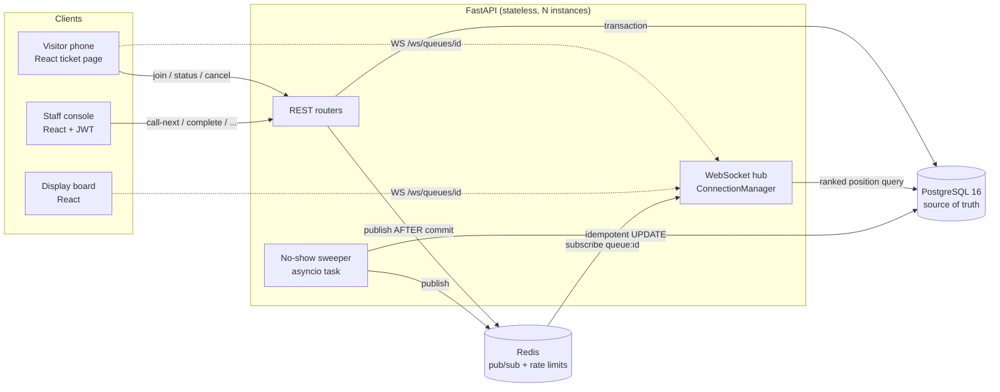
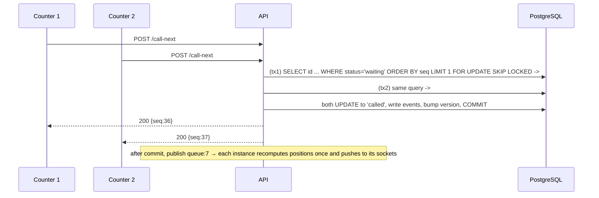
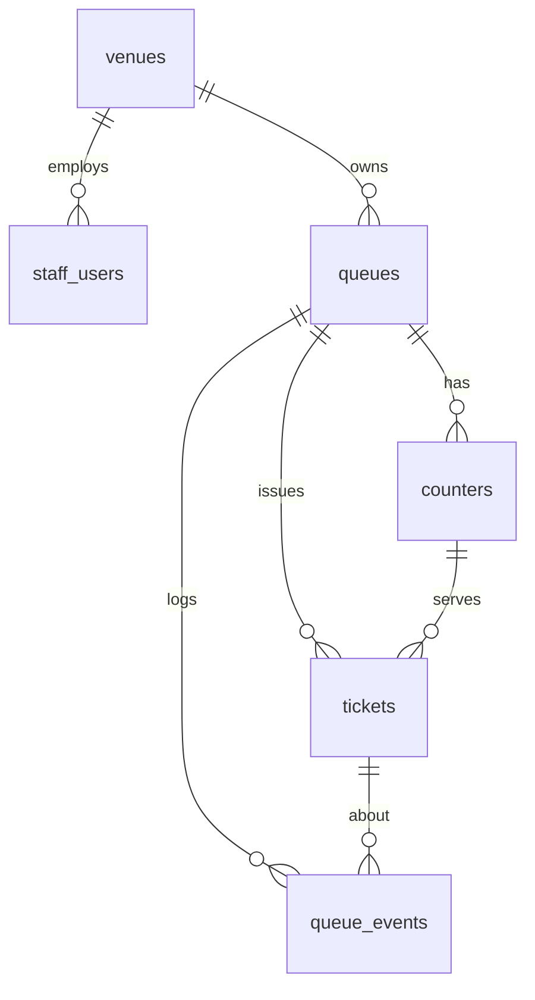
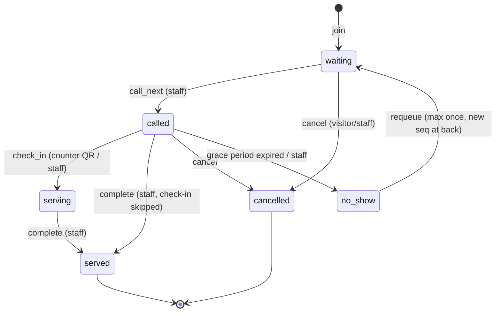
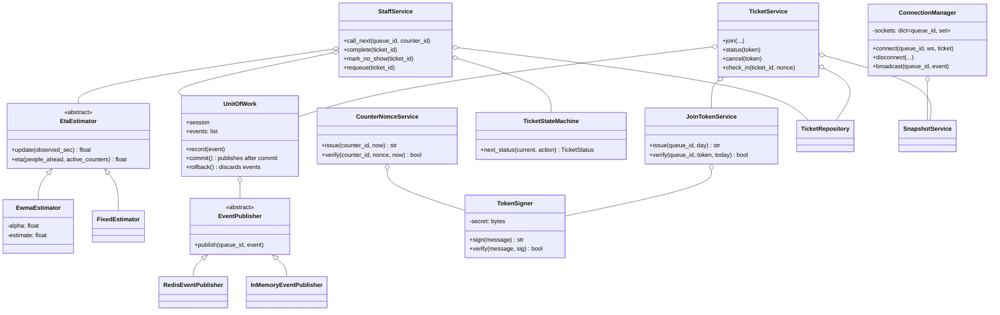

# QueueLess — System Design

> Status: **Proposed — awaiting approval before implementation.**
> Every non-obvious decision has an ADR in [`docs/adr/`](adr/). This document is the map; the ADRs are the "why".

QueueLess replaces a physical line with a virtual one. A visitor scans a QR code to join, sees their live position and ETA on their phone, and walks up when called. Staff call the next person, check visitors in, and mark them served, cancelled or no-show.

---

## Part A — High-Level Design (HLD)

### A1. Requirements

**Functional (MVP)**

| # | Requirement |
|---|---|
| F1 | A venue (tenant) has many queues; a queue has many counters |
| F2 | A visitor joins by scanning a signed **join QR**, with no account |
| F3 | A visitor sees live position, now-serving number, ETA and queue status |
| F4 | A visitor can cancel their own ticket |
| F5 | Staff (JWT login) can call next, complete, mark a no-show, requeue once, and pause, close or open a queue |
| F6 | Check-in at the counter by scanning a rotating **counter QR** (or done by staff) |
| F7 | A called ticket that isn't checked in within the grace period becomes `no_show` automatically |
| F8 | ETA uses a rolling (EWMA) service-time estimate |
| F9 | Display board view (now serving per counter) |
| F10 | Stats: served count, average wait, ETA error |

**Out of scope (and I'll say so if asked):** payments, appointment slots, native apps, SMS/WhatsApp, multi-region, ML-based ETA.

**Non-functional targets (to be *measured* by `scripts/queueless_load.py`, not assumed)**

| Property | Target | How we get there |
|---|---|---|
| Correctness under concurrency | 0 duplicate seq numbers, 0 double-called tickets | Row lock on queue for join; `FOR UPDATE SKIP LOCKED` for call-next; compare-and-set transitions |
| Idempotency | A retried join never creates a second ticket | `UNIQUE(queue_id, client_request_id)` |
| Live update latency | p95 < 500 ms from staff action to visitor screen | commit → Redis pub/sub → WS push; one ranked query per event per instance |
| Scale (single node) | 100+ simultaneous participants, 1,000+ events | async FastAPI, indexed partial queries |
| ETA quality | < 20 % median absolute percentage error | EWMA estimator, measured per served ticket |
| Durability | No ticket lost if Redis or a socket dies | PostgreSQL is the source of truth; Redis is transport only |

### A2. Back-of-envelope sizing

A busy campus event has about 2,000 visitors a day across about 5 queues. The peak is about 100 joins/min and roughly 3 staff actions/s.
Each staff action fans out to ≤ 200 connected sockets, so about 600 small (≈150 B) WebSocket messages/s at peak, which one API process handles easily.
Storage is about 2,000 tickets plus about 10,000 events per day, roughly 5 MB/day. A single PostgreSQL instance is more than enough, so the hard part is **correctness under concurrency, not volume**.

### A3. Architecture



| Component | Responsibility | Why this choice |
|---|---|---|
| React (+ React Router) SPA | Three routes: `/t/:token` visitor, `/staff` console, `/board/:queueId` display | One codebase; nothing to install after scanning a QR |
| FastAPI | REST for actions, WebSockets for live updates, JWT for staff | Typed Pydantic validation, DI for auth and venue scoping, native async WS. The same stack as my other projects |
| PostgreSQL | Queues, tickets, the append-only event log, and all concurrency control | Transactions plus row locks make "two staff press call-next at once" safe ([ADR-0002](adr/0002-skip-locked-call-next.md)) |
| Redis | Pub/sub fan-out across API instances, and per-IP join rate limiting | WebSocket clients are spread over instances, so an instance-local broadcast isn't enough ([ADR-0005](adr/0005-redis-pubsub-versioned-events.md)) |
| No-show sweeper | Every 10 s, marks overdue called tickets `no_show` | A single idempotent `UPDATE ... WHERE`, so it's safe if several instances run it ([ADR-0008](adr/0008-no-show-sweeper-in-process.md)) |
| Docker Compose | `api`, `web`, `postgres`, `redis` | Reproducible demo |

**Why no Celery here (unlike RepoLens and Deploy-Lite):** every QueueLess request is short (one transaction, a few ms). The only periodic work is a single idempotent SQL statement, so a separate worker and broker would add operational cost without benefit ([ADR-0008](adr/0008-no-show-sweeper-in-process.md)).

### A4. Key flows

**Join (visitor scans the QR)**

```mermaid
sequenceDiagram
  participant B as Browser
  participant A as API
  participant P as PostgreSQL
  participant R as Redis
  B->>A: POST /api/queues/7/tickets {join_token, client_request_id, device_id}
  A->>R: INCR rate:join:{ip} (limit / minute)
  A->>A: verify HMAC join token (today or yesterday's key)
  A->>P: BEGIN; UPDATE queues SET next_seq=next_seq+1, version=version+1 WHERE id=7 AND status='open' RETURNING ...
  A->>P: INSERT ticket ... ON CONFLICT (queue_id, client_request_id) DO NOTHING
  A->>P: INSERT queue_events(type='joined'); COMMIT
  A->>R: PUBLISH queue:7 {type:'joined', version}
  A-->>B: 201 {id, seq, token, position, eta_seconds, now_serving}
  B->>A: WS /ws/queues/7?ticket=token
  A-->>B: snapshot (always sent first)
```

**Call next (two counters at once)**



### A5. Consistency and realtime model

* **PostgreSQL is the truth.** Redis can lose a message and nothing is lost. Clients just see an update late.
* **Publish after commit.** Never announce a change that might roll back ([ADR-0006](adr/0006-publish-after-commit.md)).
* **Versioned events.** `queues.version` is incremented in the same transaction as the change. A client that sees a version gap asks for a fresh snapshot, so pub/sub loss heals itself.
* **Snapshot on connect.** A late or reconnecting socket is never stale.
* **Fallback.** If the socket is closed, the UI polls `GET /api/tickets/{token}` every 3 s.
* **Heartbeat.** The server pings every 25 s and drops dead sockets.

### A6. Failure modes

| Failure | Behaviour | At scale I would… |
|---|---|---|
| Redis down | Actions still commit; live pushes stop; clients fall back to polling; the join rate limiter fails **open** and logs it | Use Redis Sentinel/managed Redis; a durable stream if replay is needed |
| API instance dies | Its sockets drop; clients reconnect to another instance and get a snapshot | Put a load balancer with health checks in front |
| Two staff call next together | SKIP LOCKED gives them different tickets | (already safe) |
| Network retry on join | Same `client_request_id` returns the existing ticket | (already safe) |
| Sweeper on several instances | Idempotent UPDATE: the second run matches zero rows | Use advisory-lock leader election if it does more work |
| Photographed join QR shared online | The daily-rotated key expires it; per-IP rate limit; one active ticket per device | Add CAPTCHA or venue Wi-Fi gating |
| Remote check-in attempt | A counter nonce valid for 30–60 s is only visible on the counter screen | (already safe) |

### A7. Security

| Asset | Mechanism | ADR |
|---|---|---|
| Join QR | `HMAC-SHA256(daily_key, queue_id \| date)`; accepts today's and yesterday's key (midnight grace) | [0004](adr/0004-qr-token-design.md) |
| Ticket ownership | 128-bit random token from `secrets.token_urlsafe(16)`; **only its SHA-256 is stored** | [0004](adr/0004-qr-token-design.md) |
| Counter check-in | `HMAC(key, counter_id \| 30 s window)`; accepts current and previous window | [0004](adr/0004-qr-token-design.md) |
| Staff | JWT (HS256, 60 min) with `sub`, `venue_id`, `role`; the user is **reloaded from the DB** on every request so deactivation takes effect immediately | [0009](adr/0009-staff-jwt-venue-scope.md) |
| Tenant isolation | Every staff query is filtered by `venue_id` from the authenticated user, never from the request body | [0009](adr/0009-staff-jwt-venue-scope.md) |
| Abuse | Redis per-IP join rate limit; partial unique index allows one active ticket per device per queue | [0004](adr/0004-qr-token-design.md) |

### A8. Scaling path (for "how would this handle a stadium?")

1. Run stateless API instances behind a load balancer; Redis is already the cross-instance fan-out.
2. Shard by `queue_id`: every transaction touches one queue row, so queues never contend with each other.
3. Push only deltas (now-serving and version). Clients compute their own position from `seq` and the waiting list, or the instance batches one ranked query per event.
4. Move WebSockets to a managed gateway, use SSE for read-only display boards, and add a PgBouncer connection pool and a read replica for stats.

---

## Part B — Low-Level Design (LLD)

### B1. Layered architecture

```
api (routers, schemas, DI)          ← HTTP/WS only: parse, authorize, map errors
  ↓
services (use cases)                ← orchestrate one transaction per use case
  ↓                ↘
domain (pure Python)     events (publisher interface)
  state machine, estimator, tokens        Redis / in-memory implementations
  ↓
repositories (SQL)                  ← the only place that knows SQL / SKIP LOCKED
  ↓
db (SQLAlchemy models, session, Alembic)
```

**Dependency rule:** arrows point down only. `domain/` imports nothing from FastAPI, SQLAlchemy or Redis, so it's unit-testable with no database ([ADR-0010](adr/0010-layered-architecture.md)).

### B2. Package layout

```
backend/
  app/
    main.py                  # create_app() factory: routers, lifespan (Redis listener, sweeper)
    core/config.py           # Settings (pydantic-settings), single source of config
    core/security.py         # password hashing, JWT encode/decode
    core/errors.py           # DomainError hierarchy → HTTP mapping
    db/base.py, db/session.py
    db/models.py             # SQLAlchemy ORM: Venue, StaffUser, Queue, Counter, Ticket, QueueEvent
    domain/ticket_state.py   # TicketStatus enum + TicketStateMachine (allowed transitions)
    domain/estimator.py      # EtaEstimator (ABC), EwmaEstimator, FixedEstimator, factory
    domain/tokens.py         # TokenSigner (HMAC), JoinTokenService, CounterNonceService, TicketTokens
    domain/events.py         # QueueEventType enum, DomainEvent dataclass
    repositories/queue_repo.py
    repositories/ticket_repo.py
    repositories/event_repo.py
    services/unit_of_work.py # UnitOfWork: transaction + collected events published after commit
    services/ticket_service.py   # join, status, cancel, check_in
    services/staff_service.py    # call_next, complete, no_show, requeue
    services/queue_service.py    # create/pause/close/open, qr, stats
    services/snapshot_service.py # builds visitor/board snapshots (position, ETA, now serving)
    events/publisher.py      # EventPublisher (ABC), RedisEventPublisher, InMemoryEventPublisher
    realtime/hub.py          # ConnectionManager: per-queue socket registry, fan-out
    realtime/redis_listener.py
    workers/no_show_sweeper.py
    api/deps.py              # get_session, get_current_staff, require_role
    api/schemas.py           # Pydantic request/response models
    api/routers/{auth,queues,tickets,staff,ws}.py
  alembic/                   # migrations
  tests/{unit,integration,api}/
frontend/                    # React + React Router + plain CSS
scripts/                     # concurrency_demo.py, eta_simulation.py, queueless_load.py, common.py
docs/                        # this file + ADRs + results
```

### B3. Database schema



| Table | Columns | Constraints and indexes |
|---|---|---|
| `venues` | id, name, created_at | |
| `staff_users` | id, venue_id FK, email, password_hash, role (`staff`/`admin`), is_active | `UNIQUE(email)` |
| `queues` | id, venue_id FK, name, status (`open`/`paused`/`closed`), next_seq, **version**, default_service_sec, est_service_sec, no_show_grace_sec, max_requeues | `CHECK status IN (...)` |
| `counters` | id, queue_id FK, label, active | |
| `tickets` | id, queue_id FK, seq, status, token_hash, client_request_id, device_id, counter_id FK, requeue_count, eta_at_join_sec, joined_at, called_at, checked_in_at, served_at, closed_at | `UNIQUE(queue_id, seq)`, `UNIQUE(queue_id, client_request_id)`, `UNIQUE(token_hash)`, **partial index** `(queue_id, seq) WHERE status='waiting'`, **partial unique** `(queue_id, device_id) WHERE status IN ('waiting','called','serving')` |
| `queue_events` | id, queue_id FK, ticket_id FK NULL, type, actor, version, at, payload JSONB | index `(queue_id, at)`, append-only |

**Positions are computed, never stored** ([ADR-0001](adr/0001-computed-positions.md)):
`position = count(waiting tickets in queue with seq < mine) + 1`, served by the partial index.

`eta_at_join_sec` is stored so the ETA error can be measured honestly after the ticket is served.

### B4. Ticket state machine



* Implemented as a **transition table** in `TicketStateMachine` (`{(from, action): to}`), not if/else chains, so adding a state is a data change ([ADR-0003](adr/0003-state-machine-cas-transitions.md)).
* Enforced **twice**:
  1. In Python, to produce a clear `InvalidTransition` error (HTTP 409).
  2. In SQL, as a compare-and-set: `UPDATE tickets SET status=:to WHERE id=:id AND status=:from`. If zero rows match, someone else won the race, so we return 409. Two staff completing the same ticket can't both succeed.

### B5. Concurrency-critical SQL (lives only in repositories)

```sql
-- Join: the queue row lock serializes joins for THIS queue only; idempotent on retry
WITH s AS (
  UPDATE queues SET next_seq = next_seq + 1, version = version + 1
  WHERE id = :qid AND status = 'open'
  RETURNING next_seq, version)
INSERT INTO tickets (queue_id, seq, client_request_id, device_id, token_hash, eta_at_join_sec)
SELECT :qid, next_seq, :rid, :dev, :hash, :eta FROM s
ON CONFLICT (queue_id, client_request_id) DO NOTHING
RETURNING id, seq;
-- no row returned → either queue not open, or retry → service looks up the existing ticket

-- Call next: two counters get two different tickets; no blocking, no double call
WITH n AS (
  SELECT id FROM tickets
  WHERE queue_id = :qid AND status = 'waiting'
  ORDER BY seq LIMIT 1
  FOR UPDATE SKIP LOCKED)
UPDATE tickets t SET status='called', called_at=now(), counter_id=:cid
FROM n WHERE t.id = n.id
RETURNING t.id, t.seq;

-- No-show sweep: idempotent, safe on many instances
UPDATE tickets SET status='no_show', closed_at=now()
WHERE status='called' AND called_at < now() - make_interval(secs => :grace)
RETURNING id, queue_id;
```

### B6. Classes and responsibilities (OOP view)



| Class | Single responsibility | Collaborators |
|---|---|---|
| `TicketStateMachine` | Knows which transitions are legal | — (pure) |
| `EwmaEstimator` | Keeps a rolling service-time estimate and computes ETA | — (pure) |
| `TokenSigner` | HMAC sign/verify with constant-time compare | — (pure) |
| `JoinTokenService` / `CounterNonceService` | Token formats and rotation windows | `TokenSigner` |
| `QueueRepository` / `TicketRepository` / `EventRepository` | All SQL, including locking queries | SQLAlchemy session |
| `UnitOfWork` | Transaction boundary; holds domain events until commit | session, `EventPublisher` |
| `TicketService` | Visitor use cases | repos, tokens, snapshot, UoW |
| `StaffService` | Staff use cases | repos, state machine, estimator, UoW |
| `QueueService` | Admin use cases, QR, stats | repos, tokens |
| `SnapshotService` | Builds `{now_serving, position, eta_seconds, status, version}` | repos, estimator |
| `ConnectionManager` | Per-instance socket registry and fan-out | `SnapshotService` |
| `RedisEventListener` | Bridges Redis pub/sub into `ConnectionManager` | Redis, hub |
| `NoShowSweeper` | Periodic idempotent sweep | repo, UoW |

### B7. Design patterns used (and where)

| Pattern | Where | Why it earns its place here |
|---|---|---|
| **Repository** | `repositories/*` | Keeps `FOR UPDATE SKIP LOCKED` and CTE SQL in one place; services read like use cases |
| **Unit of Work** | `services/unit_of_work.py` | One transaction per use case; events are buffered and **published only after commit** and discarded on rollback |
| **Service layer** | `services/*` | Routers stay thin (parse → call → map), and the same use case is reusable from HTTP, the sweeper and tests |
| **State** (table-driven) | `domain/ticket_state.py` | Legal transitions as data; illegal ones fail loudly |
| **Strategy** | `EtaEstimator` → `EwmaEstimator` / `FixedEstimator` | Swap the ETA algorithm via config; the simulation compares strategies with the same interface |
| **Factory** | `create_app()`, `build_estimator(settings)` | Test and prod wiring differ (in-memory publisher vs Redis) without `if TESTING` branches in business code |
| **Observer / Pub-Sub** | `EventPublisher` → Redis → `ConnectionManager` → sockets | Producers don't know who listens; instances scale horizontally |
| **Adapter** | `RedisEventPublisher`, `InMemoryEventPublisher` | Same interface over different transports; tests run without Redis |
| **Dependency Injection** | FastAPI `Depends` (`get_current_staff`, `require_role("admin")`, services) | Auth and venue scoping are declared per route; easy to override in tests |
| **Idempotency key** | `client_request_id` + unique constraint | Safe network retries |
| **Compare-and-set** | `UPDATE ... WHERE status = :expected` | Lock-free race detection on transitions |
| **Event log / audit** | `queue_events` (append-only) | Audit trail, stats, and offline replay to tune α |

### B8. OOP principles applied

| Principle | Concretely in QueueLess |
|---|---|
| **Encapsulation** | Ticket status can only change through `TicketStateMachine` plus the repository's CAS update. Nothing assigns `ticket.status = ...` directly. The raw ticket token never leaves `TicketTokens` except to the visitor; the DB stores only its hash |
| **Abstraction** | `EtaEstimator` and `EventPublisher` are ABCs. Services depend on "something that can estimate" and "something that can publish", not on Redis or the EWMA formula |
| **Inheritance** | Kept shallow and used only for interface implementation (ABC → concrete) and the SQLAlchemy `Base`. No deep hierarchies |
| **Polymorphism** | `StaffService` calls `estimator.update()` without knowing the strategy. `UnitOfWork` calls `publisher.publish()` and gets Redis in prod and in-memory in tests |
| **Composition over inheritance** | Services are *composed* of repos, a state machine, an estimator and a publisher, injected via constructor ([ADR-0010](adr/0010-layered-architecture.md)) |
| **S**RP | One reason to change per class (table in B6) |
| **O**CP | A new ETA model means a new `EtaEstimator` subclass with no edits to services. A new state means a table entry |
| **L**SP | Any `EventPublisher` can replace another; tests prove it by running the same service tests with the in-memory publisher |
| **I**SP | Small interfaces: the publisher has one method, the estimator two |
| **D**IP | Services depend on abstractions; concrete classes are wired in the `create_app()` composition root |

### B9. API contract

| Method & path | Auth | Request | Success | Errors |
|---|---|---|---|---|
| `POST /api/auth/login` | — | `{email, password}` | 200 `{access_token}` | 400 malformed, 401 bad creds |
| `GET /api/me` | staff | — | 200 user | 401 |
| `POST /api/queues` | admin | `{name, counters, default_service_sec}` | 201 queue | 403 |
| `GET /api/queues` | staff | — | 200 venue's queues | |
| `PATCH /api/queues/{id}` | admin | `{status?, default_service_sec?, ...}` | 200 | 404 other venue, 409 bad status |
| `GET /api/queues/{id}/qr` | admin | — | 200 `{join_url, join_token, png_base64}` | |
| `GET /api/queues/{id}/public` | — | — | 200 name, status, now serving, waiting count | 404 |
| `POST /api/queues/{id}/tickets` | join token | `{join_token, client_request_id, device_id?}` | 201 `{id, seq, token, position, eta_seconds, now_serving, status}` (200 on idempotent replay) | 403 bad token, 409 paused/closed or active ticket exists, 429 rate limit |
| `GET /api/tickets/{token}` | ticket token | — | 200 snapshot | 404 |
| `DELETE /api/tickets/{token}` | ticket token | — | 200 | 409 not cancellable |
| `POST /api/queues/{id}/call-next` | staff | `{counter_id?}` | 200 `{id, seq, counter}` | 404 nobody waiting, 409 closed |
| `GET /api/counters/{id}/nonce` | staff | — | 200 `{nonce, expires_in, checkin_url}` | |
| `POST /api/tickets/{id}/check-in` | ticket token + counter nonce, **or** staff | `{token, nonce}` | 200 | 403, 409 |
| `POST /api/tickets/{id}/complete` | staff | — | 200 | 409 |
| `POST /api/tickets/{id}/no-show` | staff | — | 200 | 409 |
| `POST /api/tickets/{id}/requeue` | staff | — | 200 new seq | 409 limit reached |
| `GET /api/queues/{id}/stats` | admin | — | 200 `{served, avg_wait_sec, eta_mape, eta_median_ape, est_service_sec}` | |
| `WS /ws/queues/{id}?ticket=` | ticket token (optional for board) | — | snapshot, then events | close 4404 |

**WebSocket messages:** `{"type": "snapshot"|"update"|"ping", "version", "queue_status", "now_serving", "position", "eta_seconds", "ticket_status"}`. These are per-visitor and under about 200 bytes.

**Error shape** (every error): `{"error": {"code": "QUEUE_CLOSED", "message": "..."}}`, produced by one exception handler that maps the `DomainError` hierarchy ([ADR-0011](adr/0011-error-hierarchy.md)).

### B10. ETA model

* `ETA = (people_ahead + 1) × est_service_sec ÷ max(1, active_counters)`
* `est ← α·observed + (1−α)·est` on every `complete`, with α = 0.2 by default (configurable). Observed time is `served_at − called_at`.
* Cold start: `est = default_service_sec` until the first observation.
* Measurement: `eta_at_join_sec` vs the actual `called_at − joined_at`, excluding waits under 5 s. Reported as median and mean APE in `/stats` and the load test ([ADR-0007](adr/0007-ewma-eta-estimator.md)).

### B11. Testing strategy

| Level | What | Tool |
|---|---|---|
| Unit | State machine (every legal and illegal transition), estimator math, token sign/verify/rotation | pytest, no DB |
| Integration | Concurrent join (45 requests, 5 retries → 40 tickets), concurrent call-next (2×20 → 0 double calls), CAS transition race, sweeper idempotency | pytest + real PostgreSQL |
| API | Auth, venue isolation (staff of venue A gets 404 on venue B), token checks, status codes, error shape | pytest + httpx |
| Realtime | Snapshot on connect, update after call-next, version gap → resync | pytest + WS test client |
| Load / accuracy | `scripts/queueless_load.py`: p95 update latency, ETA error, 1,000+ events | recorded in `docs/RESULTS.md` with hardware noted |
| CI | GitHub Actions: lint (ruff), backend tests against Postgres and Redis services, frontend build | |

### B12. Build plan → commits

| Commit | Content |
|---|---|
| 1 | Design docs (this file and the ADRs) |
| 2 | Schema, Alembic migration, repositories, join/call-next transactions, concurrency tests |
| 3 | Domain (state machine, estimator, tokens), services, UoW, visitor endpoints, staff JWT auth |
| 4 | WebSocket hub, Redis pub/sub fan-out, versioned events, snapshot-on-connect |
| 5 | React: visitor ticket page, staff console, display board |
| 6 | QR generation (join and rotating counter nonce) and the check-in flow |
| 7 | No-show sweeper, pause/close, requeue policy |
| 8 | Stats endpoint, ETA error tracking, simulation script |
| 9 | Docker Compose, GitHub Actions CI, README with diagrams |
| 10 | Load test run and `docs/RESULTS.md` with measured numbers |
